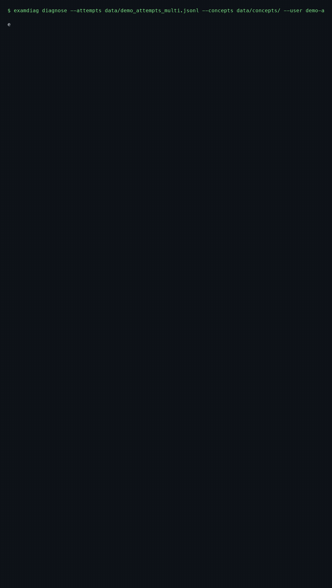

# exam-diag

找出每道错题背后的**根因概念**——而不是再做一本错题本。



## 安装

```bash
pip install -e .
```

## 使用

```bash
# 你真正该补的是哪些上游概念？（附未来 7 天复习计划）
examdiag diagnose --attempts data/demo_attempts.jsonl --concepts data/concepts/ --plan

# 供脚本消费的 JSON 输出
examdiag diagnose --attempts data/demo_attempts.jsonl --concepts data/concepts/ --json
```

在仓库自带的示例数据上，引擎输出：

```
┃ 1 │ 二叉树遍历 ds.tree.traverse │ 掌握度 0.10 │ 涉及错题 26 │
    补习路径: 二叉树遍历 → 二叉搜索树 → AVL平衡旋转 → AVL删除
```

——也就是说，BST 旋转题连续做错，真正的问题出在**二叉树遍历**没学会。

## 为什么不是又一个错题本

错题本记录的是你"错在哪"；exam-diag 回答的是"**为什么错**"：

1. 每次作答按题目挂载的概念拆分归因；
2. 对每个概念拟合贝叶斯知识追踪模型（前向后验 + EM，纯 numpy 实现）→ 掌握概率；
3. 错题沿**前置依赖图向上游回溯**——一个失败概念若其前置也未掌握，它只是症状；
   处于最上游的破损概念才是根因；
4. 每个根因附带补习路径与未来 7 天的间隔重复计划（间隔与掌握度成反比）。

## 仓库里有什么

- `examdiag/` —— BKT 引擎、DAG 操作、根因诊断、复习调度、命令行
- `data/concepts/` —— 四科知识图谱共 240 个概念（408 / math1 / english / politics）
- `data/questions/` —— 600 道自建选择题，用于演示与测试
- `benchmark.md` —— 下次作答预测基准（自写 BKT 在合成数据上 AUC 0.79）
- `viz/report.html` —— 示例诊断的单文件可视化（浏览器直接打开）
- `examples/demo.ipynb` —— 可一键运行的笔记本

数据格式见 [docs/DATA_FORMAT.md](docs/DATA_FORMAT.md)。无登录、无云端、零配置，
全部本地运行。MIT 许可。

English docs in [README.md](README.md)。
