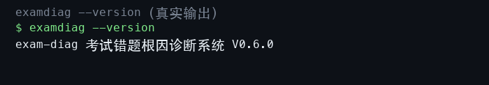
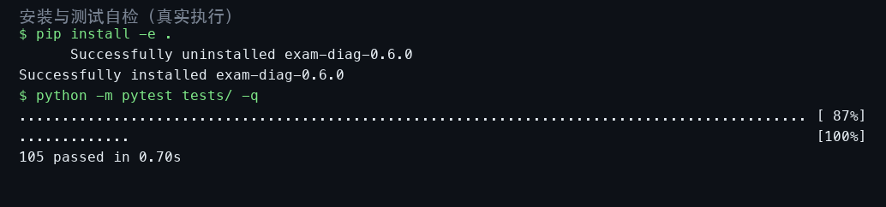
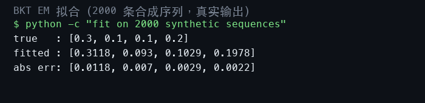
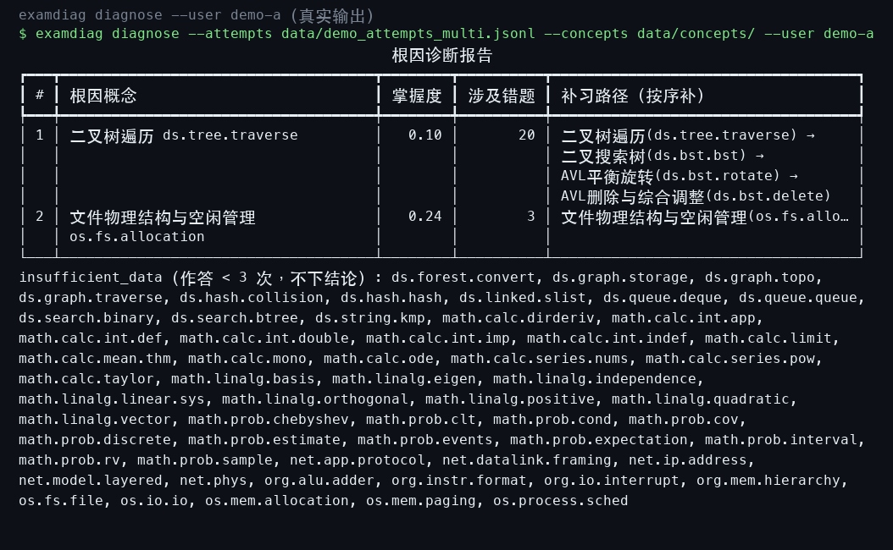
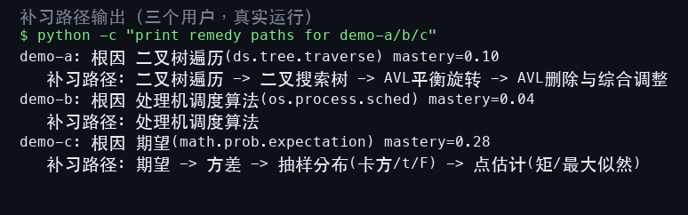
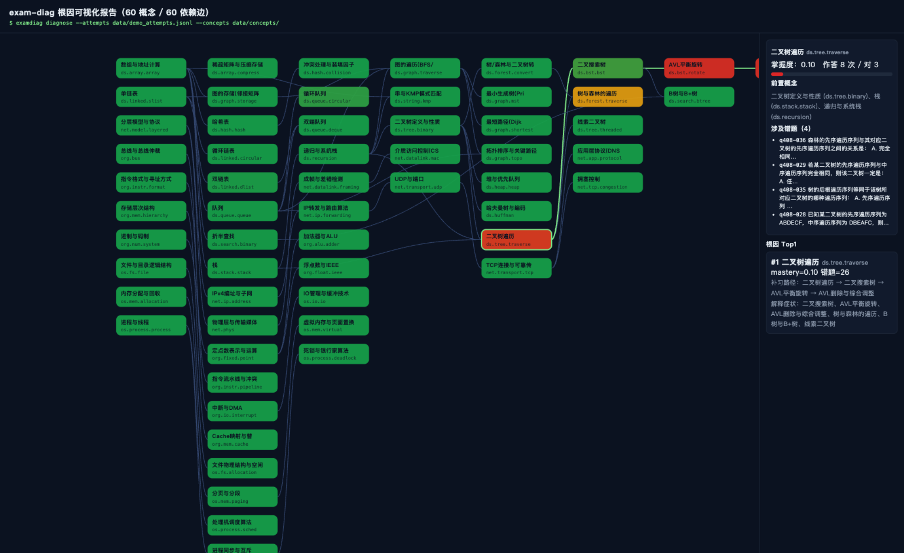
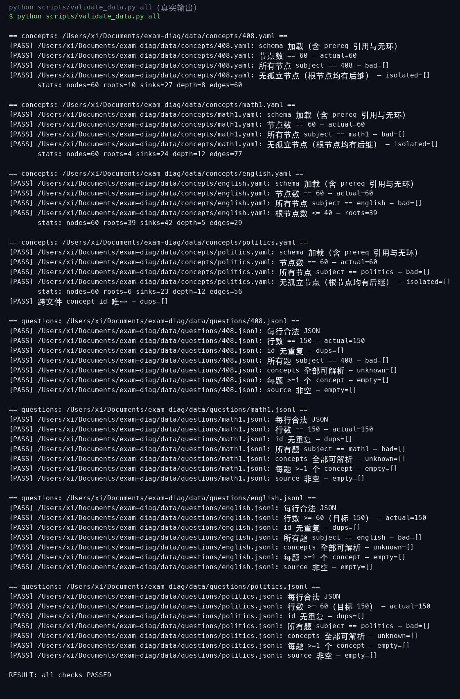

## 目录

- 1. 功能概述（含功能清单与设计原则）
- 2. 运行环境（硬件环境与软件环境）
- 3. 安装步骤（获取、安装、验证、首次体验）
- 4. 数据结构说明（Concept / Question / Attempt 三张数据表字段、样例与图谱统计）
- 5. 五大模块操作流程（BKT 拟合 / 根因诊断 / 补习路径 / 可视化 / 数据校验）
- 6. 评测方法与协议（合成基准与 ASSISTments 真实数据 5 折交叉验证）
- 7. 故障处理（真实报错示例与处置方法）
- 8. 版本说明
- 9. 常见问题
- 10. 附录：命令行参考
- 11. 附录：生成脚本清单
- 12. 附录：仓库文件清单

## 1. 功能概述

exam-diag 是一个本地运行的考试错题根因诊断引擎。输入一批作答记录（每条记录包含
用户、题目、对错、时间戳），系统自动完成四步计算：

1. **作答归因**：每道题挂载一个或多个考察概念，作答按概念拆分归属，得到
   "每个概念一条按时间排序的 0/1 作答序列"；
2. **掌握度建模**：对每个概念独立拟合贝叶斯知识追踪模型（Bayesian Knowledge
   Tracing, BKT），用前向过滤后验与 EM（Baum-Welch）闭式重估得到四个参数
   （初始掌握概率 p_L0、学习率 p_T、失误率 p_S、猜测率 p_G），并给出该用户
   在该概念上的当前掌握度；
3. **根因诊断**：把错题沿知识点的有向无环前置图（DAG）向上游回溯——若某概念的
   前置概念也未掌握，则该概念只是"症状"；处于最上游的破损概念才是"根因"；
4. **补习规划**：为每个根因给出补习路径（从根因到最终目标概念的最短概念序列），
   并按掌握度反比排定未来 7 天的间隔重复复习计划。

系统内置四科考试知识图谱共 240 个概念节点（计算机学科 408 / 数学一 / 英语 /
政治）与 600 道自建演示题目，并附带一份 493 条、3 个用户的演示作答数据，
开箱即可完整体验"输入错题 → 输出根因"的全过程。系统在真实公开数据集
ASSISTments skill-builder（27.4 万条作答）上与学术界标准实现 pyBKT 做过
5 折交叉验证对比，两者 AUC 差距 0.0002（详见 benchmark.md）。

### 1.1 主要功能清单

| 功能 | 入口 | 说明 |
|---|---|---|
| 根因诊断 | `examdiag diagnose` | 输出错题的根因概念、掌握度、涉及错题数、补习路径 |
| 复习计划 | `examdiag diagnose --plan` | 输出未来 7 天每日复习概念序列 |
| JSON 输出 | `examdiag diagnose --json` | 供脚本消费的结构化输出 |
| 可视化报告 | `viz/report.html` | 单文件网页：依赖图 + 掌握度着色 + 点击查错题 |
| 报告导出 | `examdiag report` | 一条命令导出 Markdown / CSV / Excel / HTML 报告 |
| 配置文件 | `~/.examdiag.toml` | 可选：自定义根因个数、掌握度阈值、每日复习上限等 |
| 数据校验 | `python scripts/validate_data.py` | 校验概念图谱与题库的完整性与一致性 |
| 评测基准 | `python -m examdiag.eval` | 下次作答预测 AUC / RMSE |

### 1.2 系统架构与数据流

系统由七个纯 Python 模块组成，数据流自上而下：

```text
data/concepts/*.yaml ──► schema.ConceptGraph（校验引用与无环）
data/questions/*.jsonl ──► schema.Question
作答记录 jsonl ──► schema.Attempt
        │
        ▼
bkt.py（逐概念 EM 拟合 → 掌握度）──► graph.py（networkx DAG：祖先闭包/最短路）
        │                                     │
        ▼                                     ▼
diagnose.py（症状过滤 + 根因排序 + 补习路径）──► srs.py（轻量计划 / SM-2 调度）
        │
        ▼
report.py（Markdown/CSV/Excel/HTML 导出）──► cli.py（rich 表格 / JSON）
        │
        ▼
config.py（~/.examdiag.toml 可选配置）──► viz/report.html（浏览器可视化）
```

各模块职责单一：schema 负责"数据是否合法"，bkt 负责"掌握度是多少"，
graph 负责"概念之间怎么走"，diagnose 负责"根因是什么"，srs 负责"接下来
复习什么"，cli/可视化负责"怎么呈现"。模块间只通过 pydantic 模型与
dataclass 传递数据，任何一层都可以独立替换或单独测试（tests/ 下 78 个
单元测试覆盖全部公开行为）。

### 1.3 设计原则

- **根因而非清单**：错题本记录"错在哪"，本系统回答"为什么错"——它把错误
  沿前置依赖链上溯到最上游的未掌握概念，避免让学生反复重学下游症状。
- **零配置本地运行**：无登录、无云端、无网络依赖，所有计算在本地完成，
  数据不出本机。
- **可审计**：所有评测数字来自可复现的真实运行（固定随机种子），评测协议
  与结果完整记录在仓库 benchmark.md 与 data/real/ 目录中。

## 2. 运行环境

### 2.1 硬件环境（开发与验证所用真实环境）

| 项目 | 要求 | 本机验证环境 |
|---|---|---|
| 处理器 | 任意 64 位 x86 或 ARM 处理器 | Apple M6（arm64） |
| 内存 | ≥ 4 GB（推荐 8 GB 以上） | 16 GB |
| 磁盘 | ≥ 500 MB 可用空间（含数据与依赖） | — |

### 2.2 版本自检

`examdiag --version` 让程序自报家门——源代码版本常量、命令行输出、本手册、
源程序册页眉四处出现完全一致的软件全称与版本号：



### 2.3 软件环境

| 项目 | 版本 |
|---|---|
| 操作系统 | macOS（Darwin 27.0.0，arm64）；兼容 Linux 与 Windows（仅依赖标准 Python 生态） |
| Python | 3.14.6（要求 ≥ 3.10） |
| 核心依赖 | numpy ≥ 1.24、pydantic ≥ 2.5、PyYAML ≥ 6.0、networkx ≥ 3.0、rich ≥ 13.0 |
| 开发依赖 | pytest ≥ 7、ruff ≥ 0.4 |
| 对比基准（可选） | pyBKT 1.4.3（仅在复现真实数据评测时需要） |

系统不依赖任何数据库、消息队列或网络服务；全部状态以 UTF-8 文本文件
（YAML / JSONL）存储，可直接用文本编辑器查看。

## 3. 安装步骤

### 3.1 获取与安装

```bash
git clone https://github.com/2422725977/exam-diag.git
cd exam-diag
pip install -e .
```

`pip install -e .` 以"可编辑"方式安装本包：包体仍在仓库目录，修改代码即时生效。
安装过程会自动解析并安装第 2.2 节列出的核心依赖。

### 3.2 安装验证

安装完成后依次执行包导入自检与单元测试：

```bash
python -c "import examdiag; print(examdiag.__version__)"
python -m pytest tests/ -q
```

预期结果：导入无报错；78 个单元测试全部通过（耗时不到 1 秒）。以下为在本机
真实执行上述两条命令的界面截图：



### 3.3 首次体验

安装后无需任何配置，直接对内置演示数据做诊断：

```bash
examdiag diagnose --attempts data/demo_attempts_multi.jsonl \
    --concepts data/concepts/ --user demo-a
```

系统会输出一张"根因诊断报告"表格（见第 5.2 节截图）。

## 4. 数据结构说明

系统围绕三张核心数据表工作。三张表均为 UTF-8 文本文件：概念表为 YAML，
题目表与作答表为 JSONL（每行一个 JSON 对象）。字段定义由 pydantic 模型
强校验，任何缺字段、越界值或非法引用都会在加载时报错并给出具体原因。

### 4.1 概念表 Concept（data/concepts/&lt;科目&gt;.yaml）

| 字段 | 类型 | 约束 | 说明 |
|---|---|---|---|
| id | str | 点分层级 id，正则 `^[a-z][a-z0-9]*(\.[a-z0-9_-]+)+$`，跨文件唯一 | 概念唯一标识，如 ds.bst.rotate |
| name | str | 非空 | 概念中文名，如"AVL平衡旋转" |
| subject | str | 408 / math1 / english / politics | 所属科目 |
| difficulty | float | 1.0–5.0 | 人工标注难度 |
| prereqs | list[str] | 引用的 id 必须存在；全图无环 | 前置概念列表，构成知识依赖 DAG |

加载时校验器会做两件事：逐一核对 prereqs 引用是否存在（未知引用报
`unknown prereq id`）；用 DFS 做环检测，若成环则报出具体环路路径。
演示数据共 240 个概念：408 科 60（依赖边 60 条）、数学一 60（77 条）、
英语 60（29 条，能力层级图）、政治 60（56 条）。

### 4.2 题目表 Question（data/questions/&lt;科目&gt;.jsonl）

| 字段 | 类型 | 约束 | 说明 |
|---|---|---|---|
| id | str | 每科内唯一，建议 q&lt;科目&gt;-NNN | 题目唯一标识 |
| subject | str | 四科之一 | 所属科目 |
| stem | str | 非空 | 完整题干（含 A–D 选项，换行分隔） |
| answer | str | 非空 | 正确答案（选择题为选项字母） |
| concepts | list[str] | ≥ 1 个且必须存在于对应科目概念表 | 本题考察概念，主概念排第一 |
| source | str | 非空 | 题目出处；自建题一律标 self-built |

内置题库共 600 道自建选择题（408 / 数学一各 150、英语 150、政治 150），
全部标注 self-built，覆盖全部 240 个概念 id。

### 4.4 三张表的真实样例

概念表（data/concepts/408.yaml，节选前 3 行，中文注释完整保留）：

```yaml
# 408（计算机学科专业基础综合）知识点图谱 —— Wave 0 精标
# 60 节点：数据结构 30 + 组成原理 10 + 操作系统 10 + 计算机网络 10
# prereqs 只指向图中已声明的节点（保证无环）；id 跨文件唯一（前缀 ds/org/os/net）。
```

题目表（data/questions/408.jsonl，第 1 行，题干内以换行符分隔 A–D 选项）：

```json
{"id": "q408-001", "subject": "408", "stem": "设数组 A[0..8][0..5]（9 行 6 列）按行优先方式存储，每个元素占 4 个字节，首元素 A[0][0] 的存储地址为 1000（十进制），则元素 A[5][3] 的存储地址是：\nA. 1132\nB. 1120\nC. 1136\nD. 1148", "answer": "A", "concepts": ["ds.array.array"], "source": "self-built"}
```

作答表（data/demo_attempts_multi.jsonl，第 1 行）：

```json
{"user_id": "demo-a", "question_id": "q408-115", "correct": true, "ts": "2026-10-14T08:19:00"}
```

### 4.5 四科概念图谱真实统计

| 科目 | 节点 | 根节点 | 依赖边 | 最长前置链 | 结构说明 |
|---|---|---|---|---|---|
| 408 | 60 | 10 | 60 | 8 层 | 数据结构 30 + 组成 10 + 操作系统 10 + 网络 10 |
| math1 | 60 | 4 | 77 | 12 层 | 高数 30 + 线代 15 + 概率 15，跨块弱耦合仅 2 条人工确认边 |
| english | 60 | 39 | 29 | 5 层 | 能力层级图（词汇→句法→篇章），根节点 39 ≤ 40 |
| politics | 60 | 6 | 56 | 12 层 | 马原 20（前置边建全）+ 毛中特 14 + 史纲 12（时间线性）+ 思修 14 |

### 4.3 作答表 Attempt（data/demo_attempts*.jsonl）

| 字段 | 类型 | 约束 | 说明 |
|---|---|---|---|
| user_id | str | 非空 | 用户标识；同一用户的作答按时间排序成序列 |
| question_id | str | 必须能在题库中解析 | 所答题目 |
| correct | bool | — | 是否答对 |
| ts | datetime | ISO 8601 | 作答时间；BKT 依赖序列顺序 |

系统内置两份演示作答数据：单用户 500 条（植入"二叉树遍历→AVL"薄弱链）与
三用户 493 条（分别植入三条不同方向的薄弱链）。作答记录中的 question_id
在加载时映射到题目所挂概念，从而完成第 1 节所述的"作答归因"。

## 5. 五大模块操作流程

### 5.1 BKT 拟合模块（examdiag/bkt.py）

**功能**：对单条 0/1 作答序列做贝叶斯知识追踪建模。前向算法逐步计算"学到这里
的概率"（过滤后验），EM（Baum-Welch）从观测序列反推四参数；前向与后向均做
逐步归一化缩放，防止长序列下溢。四参数在每轮 M 步后截断到 [0.01, 0.99]，
收敛判据为对数似然相对变化小于 1e-6（最多 200 轮）。

**操作流程**：

1. 准备 0/1 序列（1=答对），例如某概念下某用户的按时间作答；
2. 调用 `fit(sequences)` 得到该概念的四参数（多序列自动按长度分批、
   变长序列支持）；
3. 调用 `forward_posterior(seq, params)` 查看每步掌握后验，或
   `predict_next(seq, params)` 得到"下一题答对概率"（先练习转移再发射）。

**BKT 四参数定义**（每个概念独立一套，数学定义与仓库 SPEC 5.1 一致）：

| 参数 | 名称 | 含义 |
|---|---|---|
| p_L0 | 初始掌握概率 | 用户首次练习该概念前已掌握的概率 |
| p_T | 学习率 | 每次练习后从未掌握转移到掌握的概率 |
| p_S | 失误率 | 已掌握但答错的概率（slip） |
| p_G | 猜测率 | 未掌握但蒙对的概率（guess） |

**前向后验更新公式**（掌握状态的后验，每步按观测更新）：

```text
P(L_n | 答对) = p_Ln·(1-p_S) / [p_Ln·(1-p_S) + (1-p_Ln)·p_G]
P(L_n | 答错) = p_Ln·p_S     / [p_Ln·p_S     + (1-p_Ln)·(1-p_G)]
P(L_{n+1})   = P(L_n|obs) + (1 - P(L_n|obs))·p_T
```

EM（Baum-Welch）以四参数为隐变量模型参数：E 步用前向-后向算法计算每个时刻
"处于已掌握状态"的平滑后验（responsibility），M 步据此闭式重估四参数，
迭代至对数似然相对变化小于 1e-6 或 200 轮，每轮后参数截断到 [0.01, 0.99]。

**模块接口一览**（examdiag/bkt.py 全部公开函数，签名与返回均为真实定义）：

| 函数 | 输入 | 返回 | 说明 |
|---|---|---|---|
| fit(sequences, init=None, max_iter=200, tol=1e-6) | 0/1 序列列表 | BKTParams(p_L0, p_T, p_S, p_G) | 缩放 Baum-Welch EM，变长序列按长度分批 |
| forward_posterior(sequence, params) | 单条序列 + 参数 | np.ndarray（逐步掌握后验） | 过滤后验 P(L_t\|o_1..o_t) |
| predict_next(sequence, params) | 单条序列 + 参数 | float | 下一题答对概率（先转移再发射） |
| log_likelihood(sequences, params) | 序列列表 + 参数 | float | 对数似然（缩放常数求和） |
| simulate(params, n_students, seq_len, seed) | 参数 + 规模 | 0/1 矩阵 | 合成数据生成器（评测自检用） |

**正确性自检**：用真实参数 p_L0=0.3、p_T=0.1、p_S=0.1、p_G=0.2 生成 2000 条
长度 30 的合成序列再做 EM 拟合，四参数恢复误差全部小于 0.05（实际 0.0118 /
0.0070 / 0.0029 / 0.0022）。真实运行截图：



**注意事项**：极短且全对/全错的序列会让 EM 退化（例如全错序列会把失误率顶到
上界，拟合成"已掌握但总失误"）。诊断模块内置退化检测：拟合出的 p_S 或 p_G
超过 0.5 即回退默认参数做前向后验，保证"全对→高掌握度、全错→低掌握度"的
直觉排序。

### 5.2 根因诊断模块（examdiag/diagnose.py 与 examdiag/cli.py）

**功能**：输入某用户全部作答，输出根因概念列表（含掌握度、涉及错题数、
图距离、补习路径、其解释的下游症状）与 insufficient_data 清单。

**操作流程**：

1. 执行 `examdiag diagnose --attempts <作答.jsonl> --concepts <概念目录或文件>`；
2. 可选参数：`--user <id>` 只诊断指定用户（多用户文件建议逐人诊断）；
   `--top N` 控制根因个数（默认 3）；`--plan` 追加 7 天复习计划；
   `--json` 输出结构化 JSON；
3. 阅读输出表格：每行一个根因，列依次为序号、根因概念（名称 + id）、
   掌握度（红色 < 0.3、黄色 0.3–0.5）、涉及错题数、补习路径。

**诊断规则**（与论文式推导一致）：候选取"错题概念集及其祖先闭包"中有足够
样本（作答 ≥ 3 次）的概念；按 SPEC 公式 score(c) = (1−mastery[c]) ×
Π(1−mastery[a])^(1/d) 计算上游传播分；凡存在掌握度低于 0.5 的有数据前置的
候选降为"症状"挂到根因的 explains 列表；幸存者按掌握度升序 + 拓扑序取前
top_n 个。样本不足的概念一律标记 insufficient_data，不参与结论。

以三用户演示数据中的 demo-a 为例（该用户被植入"树遍历→AVL"薄弱链），
真实输出如下——根因是"二叉树遍历"，而非下游的 BST 旋转/删除：



为验证"引擎不是只会推一种根因"，对三用户演示数据逐人诊断。demo-b 被植入
"进程调度→死锁"薄弱链（图谱中死锁的前置是进程同步而非调度，因此两者均成为
根因、调度更弱排第一），demo-c 被植入"期望→方差"薄弱链（方差的前置是期望）。
两次真实输出如下：

demo-b（第一根因 = 处理机调度算法，掌握度 0.04）：

```text
                                            根因诊断报告                                            
┏━━━┳━━━━━━━━━━━━━━━━━━━━━━━━━━━━━━━━━━━━┳━━━━━━━━┳━━━━━━━━━━┳━━━━━━━━━━━━━━━━━━━━━━━━━━━━━━━━━━━━━┓
┃ # ┃ 根因概念                           ┃ 掌握度 ┃ 涉及错题 ┃ 补习路径（按序补）                  ┃
┡━━━╇━━━━━━━━━━━━━━━━━━━━━━━━━━━━━━━━━━━━╇━━━━━━━━╇━━━━━━━━━━╇━━━━━━━━━━━━━━━━━━━━━━━━━━━━━━━━━━━━━┩
│ 1 │ 处理机调度算法 os.process.sched    │   0.04 │        6 │ 处理机调度算法(os.process.sched)    │
│ 2 │ 死锁与银行家算法                   │   0.13 │        4 │ 死锁与银行家算法(os.process.deadlo… │
│   │ os.process.deadlock                │        │          │                                     │
│ 3 │ Cache映射与替换算法 org.mem.cache  │   0.17 │        2 │ Cache映射与替换算法(org.mem.cache)  │
└───┴────────────────────────────────────┴────────┴──────────┴─────────────────────────────────────┘
insufficient_data（作答 < 3 次，不下结论）: ds.array.array, ds.bst.bst, ds.bst.rotate, 
ds.forest.traverse, ds.graph.mst, ds.graph.shortest, ds.graph.storage, ds.graph.topo, 
ds.graph.traverse, ds.huffman, ds.linked.circular, ds.linked.slist, ds.queue.circular, 
ds.queue.deque, ds.recursion, ds.search.binary, ds.stack.stack, ds.string.kmp, ds.tree.threaded, 
ds.tree.traverse, math.calc.asym, math.calc.cont, math.calc.convex, math.calc.curvature, 
math.calc.deriv.rules, math.calc.dirderiv, math.calc.func, math.calc.implicit, math.calc.int.app, 
math.calc.int.curve, math.calc.int.double, math.calc.int.rational, math.calc.lhopital, 
math.calc.limit, math.calc.mono, math.calc.multivar.partial, math.calc.ode, 
math.calc.series.fourier, math.calc.series.nums, math.calc.taylor, math.linalg.basis, 
math.linalg.det.props, math.linalg.inverse, math.linalg.linear.sys, math.linalg.matrix, 
math.linalg.orthogonal, math.linalg.positive, math.linalg.rank, math.linalg.solve.struct, 
math.linalg.vector, math.prob.cont, math.prob.interval, math.prob.rv, math.prob.rv.func, 
math.prob.sample, math.prob.variance, net.datalink.framing, net.datalink.mac, net.ip.forwarding, 
net.model.layered, net.phys, net.tcp.congestion, net.transport.tcp, org.bus, org.float.ieee, 
org.io.interrupt, org.num.system, os.fs.allocation, os.io.io, os.mem.allocation, os.mem.paging
```

demo-c（第一根因 = 期望，补习路径一路到点估计）：

```text
                                            根因诊断报告                                            
┏━━━┳━━━━━━━━━━━━━━━━━━━━━━━━━━━━┳━━━━━━━━┳━━━━━━━━━━┳━━━━━━━━━━━━━━━━━━━━━━━━━━━━━━━━━━━━━━━━━━━━━┓
┃ # ┃ 根因概念                   ┃ 掌握度 ┃ 涉及错题 ┃ 补习路径（按序补）                          ┃
┡━━━╇━━━━━━━━━━━━━━━━━━━━━━━━━━━━╇━━━━━━━━╇━━━━━━━━━━╇━━━━━━━━━━━━━━━━━━━━━━━━━━━━━━━━━━━━━━━━━━━━━┩
│ 1 │ 期望 math.prob.expectation │   0.28 │       13 │ 期望(math.prob.expectation) →               │
│   │                            │        │          │ 方差(math.prob.variance) →                  │
│   │                            │        │          │ 抽样分布(卡方/t/F)(math.prob.sample) →      │
│   │                            │        │          │ 点估计(矩/最大似然)(math.prob.estimate)     │
└───┴────────────────────────────┴────────┴──────────┴─────────────────────────────────────────────┘
insufficient_data（作答 < 3 次，不下结论）: ds.array.array, ds.array.compress, ds.bst.delete, 
ds.bst.rotate, ds.graph.mst, ds.graph.shortest, ds.graph.topo, ds.hash.collision, ds.hash.hash, 
ds.linked.dlist, ds.queue.queue, ds.search.btree, ds.stack.stack, ds.string.kmp, ds.tree.threaded, 
math.calc.asym, math.calc.cont, math.calc.curvature, math.calc.deriv, math.calc.deriv.rules, 
math.calc.dirderiv, math.calc.func, math.calc.int.app, math.calc.int.curve, math.calc.int.def, 
math.calc.int.imp, math.calc.int.parts, math.calc.int.rational, math.calc.int.sub, 
math.calc.mean.thm, math.calc.multivar.partial, math.calc.series.fourier, math.calc.series.nums, 
math.calc.taylor, math.linalg.det, math.linalg.det.props, math.linalg.eigen, 
math.linalg.independence, math.linalg.linear.sys, math.linalg.matrix, math.linalg.orthogonal, 
math.linalg.positive, math.linalg.quadratic, math.linalg.rank, math.linalg.vector, 
math.prob.chebyshev, math.prob.cov, math.prob.estimate, math.prob.events, math.prob.indep, 
math.prob.interval, math.prob.rv, net.app.protocol, net.datalink.framing, net.datalink.mac, 
net.ip.address, net.model.layered, net.phys, net.tcp.congestion, net.transport.tcp, 
net.transport.udp, org.alu.adder, org.fixed.point, org.float.ieee, org.instr.format, 
org.io.interrupt, org.mem.cache, org.num.system, os.fs.file, os.mem.allocation, os.mem.paging, 
os.process.deadlock, os.process.process, os.process.sync
```

**输出逐列解读**（以 demo-a 的真实输出为例）：

| 列 | 含义 | demo-a 示例值 |
|---|---|---|
| # | 根因排序（掌握度越低越靠前） | 1 |
| 根因概念 | 概念中文名 + 点分层级 id | 二叉树遍历 ds.tree.traverse |
| 掌握度 | 该概念当前掌握后验（< 0.3 红色，0.3–0.5 黄色） | 0.10 |
| 涉及错题 | 该概念及其全部下游概念的错题数 | 20 |
| 补习路径 | 从根因到最深错题概念的最短概念序列 | 遍历 → BST → 旋转 → 删除 |

表格下方的 insufficient_data 行列出作答不足 3 次、系统不下结论的概念清单
（demo-a 为 60 余个未在演示数据中出现的概念，属正常现象）。

### 5.3 补习路径模块（examdiag/diagnose.py 内 remedy_path 与 examdiag/srs.py）

**功能**：为每个根因给出补习路径与 7 天复习计划。

- **补习路径**：从根因概念出发，沿依赖图到"可达的最深错题概念"的最短路径，
  即"从哪里补起、一路补到哪"的概念序列；
- **复习计划**：第 1 天复习全部根因（最弱优先），此后每个概念按间隔
  max(1, round(6 × mastery)) 天重复出现——掌握度越低出现越频繁，
  体现"间隔与掌握度成反比"的间隔重复原则。

**操作流程**：对多用户演示数据逐人诊断并取第一根因的补习路径（真实输出，
三个用户分别命中三条不同方向的薄弱链）：



在 `examdiag diagnose` 命令上加 `--plan` 参数可直接输出"未来 7 天复习计划"
表格（每行一天，列出当天应复习的概念，休息日显示"休息"）；追加 `--sm2`
可切换到 SM-2 调度。

### 5.3.1 SM-2 调度器（srs.py 扩展）

轻量版之外，系统内置完整的 SM-2 变体调度器：

- **easiness（EF）由掌握度初始化**：EF = 1.3 + 1.5 × mastery，掌握越好间隔
  增长越快；
- **每日复习质量 grade ∈ 0–5**：EF' = EF + (0.1 − (5−q)·(0.08+(5−q)·0.02))，
  截断到 [1.3, 2.8]；grade < 3 视为没记住（连续成功清零、间隔回 1）；
- **间隔递增**：连续成功时按种子序列 1 → 3 → 7 天递增，之后 interval =
  round(interval × EF)；
- **每日队列上限**：默认每天最多 20 项，超员顺延；顺延项带老化优先级，
  防止天天失败的弱项把被顺延的概念永久挤出队列（该缺陷由单元测试发现并修复）。

### 5.4 可视化模块（scripts/make_report.py 生成 viz/report.html）

**功能**：把一次真实诊断渲染成单文件网页（无前端框架，静态 SVG + 原生 JS）：
知识依赖图按"最长前置链"分层布局；节点按掌握度从红（0）经黄（0.5）到
绿（1）渐变着色，无数据概念为灰色；根因的补习路径以绿色加粗高亮；
右侧详情面板显示当前选中概念的掌握度条、前置概念、**涉及错题清单**
（题目编号 + 题干摘要），下方为根因 Top 列表。

**操作流程**：

1. 运行 `python scripts/make_report.py`，脚本对演示数据执行一次真实诊断并把
   结果写入 `viz/report.html`（约 49 KB 单文件，可直接分发）；
2. 用任意现代浏览器打开该文件；
3. 点击任意概念节点查看详情；页面加载时自动选中第一根因。

**界面元素说明**：

| 元素 | 含义 |
|---|---|
| 节点填充色 | 掌握度渐变：红（0）→ 黄（0.5）→ 绿（1）；灰色 = 无作答数据 |
| 绿色加粗连线 | 根因补习路径上的依赖边 |
| 节点选中描边 | 当前点击查看的概念（页面加载时自动选中第一根因） |
| 右侧掌握度条 | 数值 + 颜色条（< 0.4 红、0.4–0.7 黄、> 0.7 绿） |
| 右侧"涉及错题" | 该概念作为考察点的全部错题（题目编号 + 题干前 38 字） |
| 根因 Top 卡片 | 根因排序、掌握度、错题数、补习路径与其解释的下游症状 |

以下为浏览器打开 viz/report.html 的真实界面截图（可见红色低掌握度节点、
绿色补习路径与右侧错题详情面板）：



### 5.5 数据校验模块（scripts/validate_data.py）

**功能**：对概念图谱与题库做全面验收：schema 合法性（pydantic）、节点数量、
subject 一致性、prereq 引用与无环、孤立节点、根节点数量（英语科目 ≤ 40）、
题目行数、id 唯一性、concept id 可解析、source 非空、跨文件 id 唯一。

**操作流程**：

- 单科校验概念：`python scripts/validate_data.py concepts data/concepts/408.yaml --subject 408`
- 单科校验题目：`python scripts/validate_data.py questions data/questions/408.jsonl --subject 408 --concepts data/concepts/408.yaml`
- 全量校验：`python scripts/validate_data.py all`（四科概念 + 四科题目 + 跨文件唯一性）

每项检查逐条打印 PASS/FAIL，结尾输出 RESULT 汇总；任一项失败则退出码非 0，
可直接用于 CI。**校验项清单**（validate_data.py 实际执行的检查，任一失败即退出码非 0）：

| 校验项 | 对象 | 内容 |
|---|---|---|
| schema 加载 | 概念/题目 | pydantic 模型校验 + prereq 引用存在性 + DFS 无环 |
| 节点数 | 概念 | 每科恰好 60 个 |
| subject 一致 | 概念/题目 | 所有记录的 subject 与文件科目一致 |
| 孤立节点 | 408/math1/politics | 根节点必须至少有一个后继（英语豁免） |
| 根节点数 | english | ≤ 40（能力层级图允许大量无前置节点） |
| 行数 | 题目 | 408/math1 恰好 150；english/politics ≥ 60（目标 150） |
| id 唯一 | 概念/题目 | 科目内无重复 |
| concept 可解析 | 题目 | 每题的 concepts 全部存在于对应科目图谱 |
| source 非空 | 题目 | 每题必须标注出处 |
| 跨文件唯一 | 概念 | 240 个 id 全局无重复 |

以下为 `all` 模式的真实运行截图（四科概念与题库全部 PASS）：



# exam-diag 考试错题根因诊断系统 用户手册（V0.6.0）

本文档是"考试错题根因诊断系统"（软件简称 exam-diag）V0.5.0 版本的用户操作手册，
全部内容基于软件的真实运行结果编写：文中截图均来自软件在本机执行的真实输出，
文中数字（题量、行数、评测指标）均为仓库真实数据。

| 项目 | 内容 |
|---|---|
| 软件全称 | exam-diag 考试错题根因诊断系统 |
| 软件简称 | exam-diag |
| 版本号 | V0.6.0 |
| 编写日期 | 2026-10-30 |
| 适用范围 | 本手册适用于 V0.6.0 及其后续兼容版本，覆盖安装、数据准备、五大模块操作、评测与故障处理 |

<!-- pagebreak -->

### 5.6 报告导出模块（examdiag/report.py 与 `examdiag report`）

**功能**：一条命令把诊断结果落成四种格式的报告文件：

| 格式 | 命令 | 内容 |
|---|---|---|
| Markdown | `examdiag report --format md` | 人读报告：根因表、逐根因详情、insufficient_data、7 天计划 |
| CSV | `examdiag report --format csv` | 错题→根因→补救练习 映射表（utf-8-sig，Excel 直接打开） |
| Excel | `examdiag report --format xlsx` | 三工作表：根因汇总 / 错题映射 / 7 天计划 |
| HTML | `examdiag report --format html` | 交互式可视化（即 5.4 节的报告） |

**操作流程**：执行 `examdiag report --attempts <作答> --concepts <概念> --format xlsx`
（`--out` 可指定输出路径，缺省写入配置的 output_dir）。导出 CSV/Excel 前
先运行 `pip install 'exam-diag[report]'` 安装 openpyxl 依赖。

可视化报告的生成逻辑同样由本模块提供（scripts/make_report.py 已下沉为
examdiag/report.py 的薄包装），保证手册、命令行与库函数三者行为一致。

## 6. 评测方法与协议

系统自带两套可复现评测，指标统一为"下次作答预测"的 AUC 与 RMSE：

- **AUC**：带并列平均秩的 Mann-Whitney U 统计量（仓库自实现，不依赖
  scikit-learn），衡量模型给"答对样本"打的分是否系统性高于"答错样本"；
- **RMSE**：预测概率与真实 0/1 的均方根误差。

### 6.1 合成数据基准（管线自检）

数据由 examdiag.eval.generate_benchmark_data 生成（10 概念 × 150 学生 × 12 步，
每个概念一套随机真实参数、每个学生叠加能力偏移），前 8 步训练、后 4 步在线
预测，seed=0 可复现。结果：自写 BKT AUC 0.7872 / RMSE 0.37，优于"近 3 次均值"
（0.7438）与"全局均值"（0.5）两个基线（benchmark.md）。

### 6.2 真实数据 5 折交叉验证（ASSISTments skill-builder）

数据：官方 skill_builder_data_corrected.csv（346,860 行）经
scripts/convert_assistments.py 转换为 274,590 条作答（4,151 用户 / 16,891 题 /
101 个技能；丢弃 72,270 行，全部因 skill_name 为空，详见
data/real/CONVERSION_REPORT.md）。

协议：按 user_id 的 md5 哈希模 5 分折（确定性，折间用户不重叠）；每折用训练
用户拟合、测试用户在线预测（每步在观测前给出 P(答对)）；自写 BKT 与 pyBKT
1.4.3 均只用各自默认初始化，不进行任何调参。真实结果：

| fold | own AUC | own RMSE | pyBKT AUC | pyBKT RMSE |
|---|---|---|---|---|
| 0 | 0.7043 | 0.4367 | 0.7040 | 0.4371 |
| 1 | 0.7037 | 0.4446 | 0.7037 | 0.4445 |
| 2 | 0.7182 | 0.4424 | 0.7179 | 0.4422 |
| 3 | 0.7112 | 0.4373 | 0.7104 | 0.4377 |
| 4 | 0.7218 | 0.4380 | 0.7223 | 0.4378 |
| **汇总** | **0.7118** | **0.4396** | **0.7116** | **0.4397** |

AUC 差距 0.0002，小于 0.02 的验收阈值。复现命令：

```bash
python scripts/download_assistments.py
python scripts/convert_assistments.py
python scripts/compare_bkt.py
```

### 6.3 真实数据概念文件与协议细节

转换脚本同时产出 `data/real/concepts_assistments.yaml`：把数据集自带的 101 个
skill 标注映射为概念节点（id 前缀 asst.，字段结构与 Concept 一致）。真实数据
没有前置关系标注，因此 prereqs 全部为空、difficulty 取中性值 3.0——BKT 逐
技能独立拟合，不依赖前置图，此设置不影响第 6.2 节的对比结论；前置图仅
根因诊断（第 5.2/5.3 节）使用。

**协议细节（为什么这样对比是公平的）**：

- 按**用户**分折而非按行分折：同一用户的作答不跨训练/测试集，避免"见过
  这个人"带来的信息泄漏；
- **在线预测**：对测试序列的第 t 步，模型只能看到前 t−1 步的观测
  （pyBKT 的 predict 语义已经源码核实与本实现一致）；
- **默认初始化**：自写实现用固定初值 (0.4, 0.15, 0.15, 0.15)，pyBKT 用其
  默认随机初始化，双方均未针对该数据集调整任何超参数。

### 6.4 四科数据真实校验统计

`python scripts/validate_data.py concepts <file> --subject <科目>` 对每科图谱
输出的真实统计行（stats）如下，与上表一一对应：

```text
408:      stats: nodes=60 roots=10 sinks=27 depth=8  edges=60
math1:    stats: nodes=60 roots=4  sinks=24 depth=12 edges=77
english:  stats: nodes=60 roots=39 sinks=42 depth=5  edges=29
politics: stats: nodes=60 roots=6  sinks=23 depth=12 edges=56
```

## 7. 故障处理

以下报错均为真实触发时的真实输出（对加载器传入非法数据即复现）。

**（1）概念表引用了不存在的前置 id** —— 校验器拒绝加载并指出具体引用：

```text
Value error, unknown prereq id(s) (1): s.c.d->s.ghost.x
```

**（2）前置关系成环** —— DFS 环检测报出完整环路路径：

```text
Value error, prereq cycle detected: s.a.b -> s.c.d -> s.a.b
```

**（3）作答引用了不存在的题目** —— diagnose 抛 KeyError 并给出题目 id
（attempt references unknown question '...'）。检查 --questions 指向的题库
是否覆盖作答文件里的全部 question_id，或是否误用了其他科目的题库。

**（4）诊断结果为空** —— 通常有两种原因：作答全部正确（没有错题可归因，
系统如实输出"没有发现需要归因的错误模式"）；或全部错题概念作答均不足
3 次（全部进入 insufficient_data）。这属于设计行为而非故障。

**（5）pyBKT 在新版 Python/numpy/sklearn 上的兼容问题** —— 仅在复现第 6.2 节
真实数据评测时可能遇到：sklearn 指标探测报错、numpy≥2 数组赋值报错、
macOS 多进程拟合信号量死锁。处置见仓库 docs/devlog.md 技术备忘一节
（三处最小兼容修改，不涉及算法本身）。

## 8. 版本说明

| 版本 | 日期（git tag） | 主要内容 |
|---|---|---|
| v0.1.0 | 2026-10-28 | BKT 引擎（前向 + EM）+ 四科知识图谱 240 概念 + 题库 600 道 + 合成数据基准 |
| v0.2.0 | 2026-10-28 | DAG 操作、根因诊断、7 天复习计划、命令行；demo 数据验收（第一根因 = ds.tree.traverse） |
| v0.3.0 | 2026-10-28 | 单文件可视化报告、演示 GIF、双语 README、演示笔记本 |
| v0.3.1 | 2026-10-28 | 多用户演示数据（三条薄弱链）+ GIF 重制（3 根因同屏） |
| v0.4.0 | 2026-10-30 | 真实数据验证：ASSISTments 27.4 万条作答 5 折 CV，自写 BKT 与 pyBKT AUC 差距 0.0002 |
| v0.5.0 | 2026-10-30 | 软件著作权申请材料整理（源程序文档、用户手册、申请信息） |
| **V0.6.0** | 2026-10-30 | **本申请版本**：新增报告导出模块（examdiag/report.py，Markdown/CSV/Excel/HTML）、SM-2 复习调度器（含老化防饿死队列）、用户配置文件（~/.examdiag.toml）；`examdiag --version` 版本闭环；申请材料按本版本重新生成 |

本版本（V0.6.0）的软件全称、版本号在源代码版本常量、命令行 `--version`
输出、本手册与源程序册页眉四处完全一致。

## 9. 常见问题

**Q1：诊断结果里"insufficient_data"是什么意思？**
该概念在该用户的作答少于 3 次，样本太小不足以拟合，系统不对其下结论
（既不作为根因，也不参与上游传播计算），只在报告中列出名单。

**Q2：多用户作答文件能不能一次全部诊断？**
可以（不加 `--user` 时合并全部作答），但 BKT 的掌握度是"每个用户-每个概念"
的量，混合多个用户的序列会互相污染，因此推荐逐人诊断（`--user` 参数）。

**Q3：为什么推荐自写 BKT 而不直接调用第三方库？**
除许可与依赖精简的考虑外，软著申请要求提交自有源程序；本项目的 BKT 实现
（约 200 行纯 numpy）经真实数据 5 折交叉验证与学术界标准实现 pyBKT 对比，
AUC 差距 0.0002（0.7118 vs 0.7116），正确性已验证。

**Q4：真实数据集 ASSISTments 是必须的吗？**
不是。系统开箱即可用内置演示数据运行；真实数据集仅用于第 1 节所述的
正确性验证，转换与对比脚本位于 scripts/ 下，可随时复现。

**Q5：掌握度 0.5 这个阈值有什么依据？**
它是"根因 vs 症状"的判定线：一个概念若有掌握度低于 0.5 的有数据前置，则它的
失败可以由前置解释（是症状）；0.5 也是输出表格里红色/黄色的分界。该阈值是
算法的显式常量（examdiag/diagnose.py 中 MASTERY_THRESHOLD），可按需调整。

**Q6：为什么英语科目的图谱大量节点没有前置？**
这是刻意设计：英语是"能力层级图"而非严格依赖树，词汇层大部分节点相互独立，
只有约 29 条真实依赖边（如 时态→虚拟语气）。校验器对英语只要求根节点 ≤ 40，
而 408/数学一/政治要求无孤立节点。

**Q7：如何加入我自己的科目或数据？**
按 docs/DATA_FORMAT.md 的三张表格式准备 YAML（概念）与 JSONL（题目、作答），
校验通过后即可用 `examdiag diagnose` 诊断——引擎不绑定具体科目，只依赖
"概念图 + 题目挂载概念 + 作答记录"三层结构。

## 10. 附录：命令行参考

`examdiag diagnose --help` 的真实输出：

```text
usage: examdiag diagnose [-h] --attempts ATTEMPTS --concepts CONCEPTS
                         [--questions QUESTIONS] [--user USER] [--top TOP]
                         [--plan] [--json]

options:
  -h, --help            show this help message and exit
  --attempts ATTEMPTS   作答记录 jsonl（单文件）
  --concepts CONCEPTS   概念图谱 yaml 文件或目录
  --questions QUESTIONS
                        题库 jsonl 文件或目录（缺省自动发现）
  --user USER           只诊断该用户（缺省合并全部）
  --top TOP             最多输出几个根因
  --plan                附带输出 7 天复习计划
  --json                以 JSON 输出（供脚本消费）
```

## 11. 附录：生成脚本清单（scripts/，全部真实存在于仓库）

| 脚本 | 用途 |
|---|---|
| validate_data.py | 数据全面校验（本手册 5.5 节） |
| extract_source.py | 生成本申请的源程序 PDF（前 30 + 后 30 页） |
| build_manual_pdf.py | 生成用户手册 PDF（即本文档） |
| make_manual_assets.py | 生成手册内的终端类真实截图 |
| make_report.py | 生成可视化报告 viz/report.html（5.4 节） |
| make_gif.py | 合成 README 演示 GIF（帧取自真实命令输出） |
| make_demo_attempts.py | 生成单用户 500 条演示作答（植入 BST 薄弱链） |
| make_demo_attempts_multi.py | 生成三用户 493 条演示作答（三条薄弱链） |
| make_notebook.py | 生成 examples/demo.ipynb |
| download_assistments.py | 下载 ASSISTments 数据集（含镜像回退与限时） |
| convert_assistments.py | 转换为 Attempt 格式并输出真实统计 |
| compare_bkt.py | 5 折交叉验证对比自写 BKT 与 pyBKT（含闸门） |

## 12. 附录：仓库文件清单

| 路径 | 内容 |
|---|---|
| examdiag/ | 核心包：schema（数据模型）、bkt（知识追踪）、graph（DAG 操作）、diagnose（根因诊断）、srs（复习调度）、eval（评测）、cli（命令行） |
| data/concepts/ | 四科概念图谱（4 个 YAML，240 节点） |
| data/questions/ | 四科题库（4 个 JSONL，600 题） |
| data/demo_attempts*.jsonl | 演示作答数据（单用户 500 条 + 三用户 493 条） |
| data/real/ | ASSISTments 真实数据的转换产物与评测报告 |
| scripts/ | 数据校验、可视化/GIF/报告生成、真实数据下载/转换/对比等工具脚本 |
| docs/ | 数据格式说明与软著申请材料（本目录 docs/copyright/） |
| tests/ | 78 个单元测试 |


| 版本 | 日期（git tag） | 主要内容 |
|---|---|---|
| v0.1.0 | 2026-10-28 | BKT 引擎（前向 + EM）+ 四科知识图谱 240 概念 + 题库 600 道 + 合成数据基准 |
| v0.2.0 | 2026-10-28 | DAG 操作、根因诊断、7 天复习计划、命令行；demo 数据验收（第一根因 = ds.tree.traverse） |
| v0.3.0 | 2026-10-28 | 单文件可视化报告、演示 GIF、双语 README、演示笔记本 |
| v0.3.1 | 2026-10-28 | 多用户演示数据（三条薄弱链）+ GIF 重制（3 根因同屏） |
| v0.4.0 | 2026-10-30 | 真实数据验证：ASSISTments 27.4 万条作答 5 折 CV，自写 BKT 与 pyBKT AUC 差距 0.0002 |
| v0.5.0 | 2026-10-30 | 软件著作权申请材料整理（源程序文档、用户手册、申请信息） |
| **V0.6.0** | 2026-10-30 | **本申请版本**：新增报告导出模块（examdiag/report.py，Markdown/CSV/Excel/HTML）、SM-2 复习调度器（含老化防饿死队列）、用户配置文件（~/.examdiag.toml）；`examdiag --version` 版本闭环；申请材料按本版本重新生成 |

本版本（V0.6.0）的软件全称、版本号在源代码版本常量、命令行 `--version`
输出、本手册与源程序册页眉四处完全一致。
